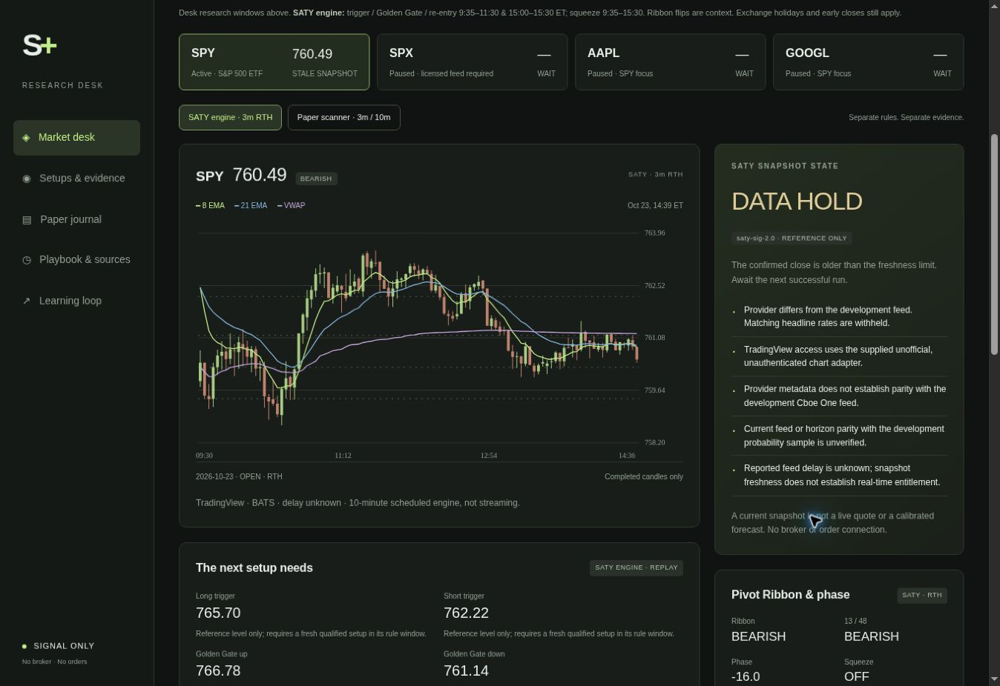

# Saty+ · SPY trading desk

**Home:** https://saty-plus-trading-desk.zestyfawn9.chatgpt.site/

The existing Saty+ desk is the home for Carter's signal-only research dashboard.
Its layout, session windows, ticker cards, level map, private paper journal and
playbook are retained. The frozen SATY engine supplies a separate 3m view,
setup journal, honest evidence, feed-health controls and learning registry.
There is no broker integration, order endpoint or options-return forecast.

`site/` is the shared frontend for the hosted home and optional GitHub Pages
mirror. It uses plain HTML, CSS, JavaScript and a canvas chart. The private home
adds a tiny dependency-free Worker for the existing R2 paper journal API. No
React, framework build, external font or chart package is required.



The screenshot is a development verification capture, not a live market view.

## Two strategies, two records

| View | What it contains | Meaning of the evidence |
| --- | --- | --- |
| SATY engine | Confirmed 3m RTH bars, Saty ATR levels, 8/13/21/34/48 ribbon, Phase Oscillator, squeeze, reference conditions and replay setups | Target-before-original-stop descriptive development counts; exact event, hits/n, sessions, Wilson interval and evidence state |
| Original paper scanner | The desk's unchanged 3m / 10m research rules, original session windows, prior/premarket/opening-range map and paper journal | CALL/PUT/WAIT are hand-set evidence weights; journal outcomes are underlying positive-R studies under this scanner's own slippage and time-exit model |
| Manual context | UW gamma, flow and dark-pool slots with observation time, instrument, method and expiry coverage | Context only; missing is not zero, stale is excluded from map, SPX is never projected directly onto SPY |
| Learning loop | Sourced candidates, one frozen challenger, explicit review gates and browser-local lesson notes | Appending a lesson cannot change or promote a production rule |

The original desk windows remain 9:30–11:00, 11:00–12:00 and 15:00–16:00 ET,
with its final-ten-minute entry cutoff. SATY's trigger/Golden Gate/re-entry
windows remain 9:35–11:30 and 15:00–15:30 ET. They are labeled separately;
one strategy's clock or outcomes never silently replaces the other's.

## Shared data and the optional Pages mirror

The home and public mirror read the same compact bundle:

`https://raw.githubusercontent.com/carterwaynereed/SATY/dashboard-data/`

The **Update shared data and Pages mirror** workflow publishes `latest.json`,
`evidence.json`, `uw.json` and `learning.json` together. Its ten-minute schedule
runs the frozen Python engine. Main owns code, manual UW input and the learning
registry; `dashboard-data` owns generated snapshots and the public replay audit.
The private paper journal remains in its existing private Site storage, outside
this bundle. External fetches never carry the private Site's credentials.

The home does not require GitHub Pages to be enabled. To activate the optional
mirror at https://carterwaynereed.github.io/SATY/:

1. In **Settings → Pages → Build and deployment → Source**, select **GitHub Actions**.
2. Ensure Actions and the official `actions/*` actions are allowed. The workflow
   requests `contents: write`, `pages: write` and `id-token: write`; repository
   policies must permit it to update the generated `dashboard-data` branch.
3. Run **Actions → Update shared data and Pages mirror → Run workflow → main**.
   Open the URL reported by the successful deployment step.

A failed Pages configuration is reported as a warning without stopping a
successful shared data update. Feed or journal-persistence failures still fail
the run. No account secrets are required in this public repository. Never add
UW cookies, Discord tokens, TradingView credentials or private journal data.

Frontend code is synchronized into the existing Site with the procedure in
[`hosting/README.md`](hosting/README.md). Both hosts continuously share data;
future **code** changes require publishing the same reviewed source to both.
A GitHub push does not by itself redeploy the private Site.

## Schedule and freshness

The cron is ten minutes, offset from the top of the hour:

```text
4,14,24,34,44,54 13-21 * * 1-5
```

This UTC envelope covers both New York offsets. The XNYS calendar gates actual
refreshes to the regular session plus a 15-minute finalization window, including
holidays and early closes. A manual run or code/data push can refresh the latest
completed session outside trading hours.

GitHub schedules can start late or be dropped under load. This is **periodic
decision context, not a streaming quote or a timely next-open entry service**.
The browser polls the four public JSON files every minute while visible and rechecks
age locally every 15 seconds. A 15-minute-old in-session price becomes stale;
refreshing the browser cannot make old data new. Public-repository schedules can
also be disabled by GitHub after prolonged inactivity; check Actions if updates
stop. See the [schedule documentation](https://docs.github.com/en/actions/reference/workflows-and-actions/events-that-trigger-workflows#schedule).

## Data and strategy integrity

- TradingView's supplied unauthenticated chart adapter is the primary source.
  It is unofficial and may be delayed or unavailable. The runner records the
  returned source metadata instead of assuming a real-time or consolidated feed.
- yfinance is a fallback. Both daily and intraday data switch together. Only
  complete sets of three one-minute bars produce a 3m candle. A fallback source
  is displayed and probability headlines are withheld for unverified parity.
- The runner requires 400 continuous prior RTH 3m bars, the session's opening
  bar, valid OHLCV, and sufficient completed daily history. Forming candles are
  excluded. ATR uses completed daily sessions before the decision session.
- The supplied engine stays frozen. Its RTH 13/48 conviction differs from Saty's
  extended-session implementation, as described in the supplied audit. Window
  definitions, context detectors, gap cohorts and the next-open model remain
  explicit. No discretionary Saty equivalence is asserted.
- Stops and targets describe modeled replay geometry. Target-before-original-
  stop outcomes and managed exits are separate. Costs, fills and option returns
  are not modeled.

The original Python files are under `engine/`. SHA-256 hashes in
[`docs/engine-manifest.json`](docs/engine-manifest.json) protect that baseline and
the supplied statistics. The original audit scripts need historical raw files
that were not included in the attachment; v1 does not claim to have rerun that
entire historical audit.

## Honest probabilities

[`stats/signal_stats_v2.json`](stats/signal_stats_v2.json) contains the supplied
34-session development sample, September 4–October 22, 2026. It is unchanged.

The evidence adapter selects **setup + cohort + target index + R bucket**. It
never counts T1/T2/T3 rows as three independent signals. It shows raw hits/total,
sessions represented in that denominator, inferred episode count, a Wilson 95%
interval, ambiguity and timeout information. The interval is descriptive and
does not correct for session clustering. Independence remains unverified because
the supplied observations lack episode IDs; they also pool direction.

The headline historical rate is withheld for fewer than 20 exact-cell events,
unknown source comparability, early-close horizon mismatch, or evidence that was
not available at the modeled decision. The evidence file was built on October
23 at 13:41:53 ET, so it cannot become an earlier October 23 prediction retroactively.
Raw historical counts remain inspectable under the **DEVELOPMENT** label.

The legacy smoothed model pooled target rows. Its diagnostics are retained as
exploratory provenance, but no unvalidated smoothed forecast is published on
setup cards. Adequate counts do not establish predictive skill or profitability.

To deterministically regenerate the compact evidence display without changing
the sample or strategy:

```bash
python scripts/summarize_evidence.py
```

## Fill the Unusual Whales slot

Edit [`site/data/uw.json`](site/data/uw.json) on `main`, preserving its schema:

1. Change `status` to `manual` after entering a real observation.
2. Set `asof` to the source observation timestamp with an offset; set `symbol`
   to `SPY` or `SPX`. Record `method`, `expiry_scope`, and gamma `units`.
3. Fill only values actually shown. Keep unavailable values as `null`.
4. Use the declared flow `window` and `classification`; do not treat call premium
   alone as proof of bullish customer buying.
5. Commit the JSON. The main-branch workflow republishes it alongside the market
   snapshot. Its freshness limit defaults to 15 minutes; expired manual context
   is labeled stale and no longer joins the level map.

SPX remains in index points. Only current, verified **SPY-basis** manual walls
join the SPY ladder. Gamma/flow/dark-pool context never changes the baseline
probability or entry rule in v1. No automated UW account access is performed.

## Private paper journal, public observations and daily learning

The original local paper monitor continues to use `scan.mjs`, `ingest.mjs` and
`sync-site.mjs`. Its existing R2 key and update API are unchanged. Its original
90-second freshness gate is separate from SATY’s scheduled 3m replay. The
public mirror can show a browser-imported paper journal, but cannot access the
private home’s journal. Browser lesson notes keep the same local-storage keys.

The workflow keeps public generated data on the **`dashboard-data`** branch:

```text
latest.json
evidence.json
uw.json
learning.json
state/index.json
state/YYYY-MM-DD/observations.jsonl
state/YYYY-MM-DD/outcomes.jsonl
state/YYYY-MM-DD/revisions.jsonl
state/YYYY-MM-DD/refreshes.jsonl
```

First observations preserve geometry, evidence hash, source, timestamp and
evidence available at observation. Later outcomes and provider revisions are
separate records. An engine decision discovered ten minutes afterward is marked
ineligible for timely-entry forward evaluation. The journal is initially a
source/latency/replay audit, not certified live strategy performance.

Use [`learning/README.md`](learning/README.md) for the daily process and promotion
gates. Six open audit questions are registered as **RESEARCH**. Add lessons as
publishable paraphrases with source locators, then preregister one testable
change. Appending a lesson never edits production rules. Any accepted challenger
requires a versioned, reviewed PR with an untouched evaluation and rollback
record. The 30-new-session/100-episode review floor is not proof of an edge.

## Local use and verification

Python 3.12 and Node 22+ are sufficient. The frontend has no dependencies. Node
runs the optional local paper scanner, tests and the dependency-free Site build.
Private scanner files under `/data/` are ignored; never force-add them.

```bash
python -m venv .venv
source .venv/bin/activate
python -m pip install -r requirements.txt
python scripts/refresh.py --init
python scripts/refresh.py --output site/data/latest.json --state-dir state
node server.mjs
```

Open `http://127.0.0.1:8765/`. The merged browser reads the shared remote SATY
bundle; `scripts/refresh.py` above is a local adapter smoke run, not an override
of the canonical shared feed. Do not open `index.html` as a `file://` URL because
the browser must fetch its JSON through HTTP.

```bash
python -m unittest discover -s tests -p 'test_*.py' -v
node --test tests/*.test.mjs
python scripts/validate_site.py
```

Tests run offline with deterministic fixtures. The CI workflow does not depend
on a market-data service being up. The deployment workflow performs the real
refresh and publishes HOLD on a feed failure when persistence succeeds. If persistence
fails, the public bundle keeps its earlier timestamp and the browser ages it
into HOLD; the workflow reports the failure. The static
validator checks strict JSON, frozen source hashes and a 500 KB artifact budget.

See [`docs/ARCHITECTURE.md`](docs/ARCHITECTURE.md),
[`docs/DATA_CONTRACT.md`](docs/DATA_CONTRACT.md), and
[`docs/supplied-audit.md`](docs/supplied-audit.md) for implementation details and
the supplied audit.
