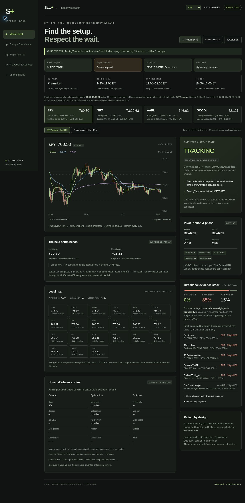

# Saty+ Trading Desk · 0.3

**Home:** https://saty-plus-trading-desk.zestyfawn9.chatgpt.site/

Saty+ is Carter's signal-only decision and research desk for **SPY, SPX, AAPL and GOOGL**. The existing layout, session strip, ticker cards, level map, paper journal and playbook are retained. Every ticker now uses the same confirmed-bar SATY implementation, with its own ATR levels, ribbon, phase, setups, feed health and development evidence. There is no broker connection, order endpoint or options-return forecast.

The shared frontend is plain HTML, CSS, JavaScript and a canvas chart. The hosted home adds a dependency-free Worker. No frontend framework, external font, chart package or npm dependency is required. Validation enforces a **500 KB static asset budget**, including the four-ticker seed snapshots and evidence bundle.



This is a QA capture of the implemented interface, not a continuously updating market image.

## Public home and live mirror

The home is publicly viewable without a ChatGPT login. Bookmark **https://saty-plus-trading-desk.zestyfawn9.chatgpt.site/** for one-click access. GitHub Pages uses the same frontend and public market API after its repository setting is enabled. Owner sign-in is optional and applies only to the private paper journal.

| Surface | Data path | Refresh and interpretation |
| --- | --- | --- |
| Hosted Saty+ home | Browser `GET /api/market` → Worker → TradingView public chart WebSocket; no login | Page polls every 15 seconds while visible. The Worker fetches new history when the next confirmed 3m bar is due, approximately its boundary plus 5 seconds. |
| GitHub Pages mirror, after enablement | Public home `/api/market` and `/api/evidence`, with credentials omitted | The same 15-second polling and cached confirmed bars as the home. Conditional requests reduce unchanged downloads. |
| Private paper journal | Protected same-origin API and original R2 record | Owner sign-in for reading, separately authenticated service uploads. Anonymous visitors and Pages cannot read these records. |
| Manual UW context | `uw.json` | Gamma, flow and dark-pool values remain MANUAL/placeholder until populated, with source time and instrument basis. |

The home monitors the entire regular session, **09:30–16:00 ET**, with the exchange calendar handling holidays and early closes. Strategy entry windows remain independent: monitoring does not stop during midday or after the last eligible setup window.

The displayed price is the close of a **confirmed three-minute bar**, not a streaming tick. Every ticker shows its source and last-bar time. The first opening candle is labeled as forming; a closed session is reference context. During the session, a confirmed close older than **225 seconds** or an actual retrieval/data-quality failure produces DATA HOLD. A refresh cannot relabel old data as live.

| Ticker | Primary TradingView symbol | Observed public source |
| --- | --- | --- |
| SPY | `AMEX:SPY` | BATS |
| SPX | `TVC:SPX`; fallback `SP:SPX` | TVC primary; the observed SP fallback reports a 600-second delay |
| AAPL | `NASDAQ:AAPL` | BATS |
| GOOGL | `NASDAQ:GOOGL` | BATS |

The page reports actual metadata and failed symbol attempts. A delayed fallback is identified and held if its bars are too old. SPX has no supplied volume, so VWAP stays unavailable. The free feed did not support a native 10m request: the 10m ribbon uses **exactly ten completed, aligned 1m bars** per candle. Missing constituents are not silently filled.

## Directional evidence weights

CALL / PUT / WAIT are **evidence allocations, not probabilities**. Their rows are 3m ribbon (25), 10m ribbon (25), 13/48 conviction (10), VWAP (15), daily ATR trigger (10), and a confirmed trigger on the latest bar (15).

Each row contributes its stated weight to bullish, bearish or neutral evidence. Let bullish total be B, bearish total S and disagreement D = min(B, S). Then:

```text
CALL = B − D
PUT  = S − D
WAIT = 100 − CALL − PUT
```

Disagreement and neutral inputs therefore go to WAIT. Fresh in-session bars use those actual rows even when no entry is eligible. Stale, unavailable or out-of-session data forces 0 / 0 / 100 while preserving the row explanation. The interface exposes the calculation and tests cover all-bullish, all-bearish, mixed and stale examples.

## Same-feed, honest development evidence

The supplied Python engine and `stats/signal_stats_v2.json` remain frozen. The new `site/data/tv-evidence.json` contains **separate 34-session replays for all four tickers**, September 4–October 22, 2026, using each ticker's actual public TradingView source. Raw captures, stable episode IDs and audit ledgers are stored under `stats/tv/`, outside website assets.

The named event is **T_i touched before the original frozen stop by 16:00 ET**, following a confirmed 3m decision and modeled next-open entry. Cells match ticker, feed fingerprint, setup, cohort, target index and reward/risk bucket. They show hits, **n**, episode/session counts, a **Wilson 95% descriptive interval**, ambiguity and evidence state. The rebuild uses uniform 3m stop-first handling with target-first sensitivity; no fills, fees or option returns are modeled.

A headline is withheld for **n < 20**, unmatched source identity, a mismatched horizon, a training cutoff reaching the decision session, or evidence that did not yet exist at that decision. Counts remain inspectable as **DEVELOPMENT** evidence. Overlapping sessions are correlated; Wilson does not correct for that dependence. Adequate n is not proof of prediction quality.

The dependency-free JS port is checked against unchanged Python over **140 ticker-session cases and 994 entry candidates**, including ATR, all five ribbon EMAs, phase, squeeze, setups, geometry, cancellations and original-stop outcomes. The engine still uses RTH 13/48 conviction; no claim of exact discretionary Saty equivalence is made. See [the evidence audit](docs/TV_EVIDENCE.md).

## Learning, manual context and paper records

`learning/` retains sourced rule candidates, one challenger versus a frozen baseline, explicit promotion gates and rollback requirements. A Discord/YouTube lesson becomes a testable hypothesis; appending it never changes production rules. The 30-new-session/100-episode review floor is a review threshold, not proof of an edge. Read [the learning process](learning/README.md).

Edit `site/data/uw.json` only with values actually observed. Set its timestamp, instrument, method, units and expiry coverage; keep unknown values null. Expired or mismatched context is excluded from the level map. SPX levels stay in index points and are not projected onto SPY. UW context does not change the frozen outcome frequency or entry rules.

The original paper scanner and its external updater are retained. Its private R2 journal key, API and browser note keys remain separate from public replay observations. Anonymous visitors and public Pages cannot read that private journal. The old scanner has its own rules and outcome definition; those records are not counted as SATY target-before-stop evidence. Updaters must use the current `sync-site.mjs`, which adds a service credential in memory while retaining the existing hidden-stdin input format; older copies are rejected. See [the update runbook](docs/desk-site-data-sync.md).

## Deployments and synchronization

A push to SATY `main` runs the shared-data/optional Pages workflow. The generated branch publishes **`market.json`, `tv-evidence.json`, `latest.json`, `evidence.json`, `uw.json` and `learning.json`**, plus the existing replay observation audit. Main owns source, evidence captures, manual inputs and learning rules. The generated branch owns scheduled references.

**A GitHub push does not automatically publish new code to the Saty+ home.** The exposed Sites capabilities provide short-lived source credentials and a short-lived publish-on-push option, not a permanent GitHub webhook. No Site credential is stored in this public repository or GitHub Actions. Both hosts read the same live market endpoint; deploying new UI code to each remains a separate release step.

For a complete manual sync, use this **one user step** in the Sites-enabled chat:

> Sync current carterwaynereed/SATY main to the existing Saty+ home and publish it, preserving its audience and journal.

The source helper, checks, packaging and native publication are then performed as one requested release. The CLI command `node hosting/sync-source.mjs /absolute/existing-site-checkout` copies source only; it **does not publish**. The operator procedure is in [hosting/README.md](hosting/README.md).

To enable https://carterwaynereed.github.io/SATY/, open [Settings → Pages](https://github.com/carterwaynereed/SATY/settings/pages), choose **Build and deployment → Source → GitHub Actions**, then open [Update shared data and Pages mirror](https://github.com/carterwaynereed/SATY/actions/workflows/dashboard.yml) and choose **Run workflow → main → Run workflow**. No starter workflow is needed. Later pushes to `main` deploy Pages automatically. Its homepage and live data require no sign-in. The current GitHub connector cannot change this repository setting; see [public access and verification](docs/PUBLIC_ACCESS.md).

The scheduled reference cron is `4,14,24,34,44,54 13-21 * * 1-5`, gated by XNYS sessions and close + 15 minutes. It maintains audit/reference files; neither host waits for it to receive live bars. GitHub can delay scheduled jobs. See [GitHub's schedule documentation](https://docs.github.com/en/actions/reference/workflows-and-actions/events-that-trigger-workflows#schedule).

## Local verification

Python 3.12 and Node 22+ are sufficient; the Action uses Node 24. Install Python requirements, then:

```sh
python -m pip install -r requirements.txt
python scripts/rebuild_tv_evidence.py --frozen
python -m unittest discover -s tests -p 'test_*.py' -v
node --test tests/*.test.mjs
python scripts/validate_site.py
```

To fetch a fresh four-ticker scheduled reference:

```sh
python scripts/refresh_tv_market.py --output site/data/market.json
```

To capture a new, separately dated development dataset, run `python scripts/rebuild_tv_evidence.py`, review its provenance and parity tests, then commit it. No automatic challenger promotion occurs. `node server.mjs` remains the optional local paper-scanner server. Private `/data/`, credentials and environment files are ignored and must never be force-added.

See [architecture](docs/ARCHITECTURE.md), [hosting](hosting/README.md), [evidence provenance](docs/TV_EVIDENCE.md), and the [supplied audit](docs/supplied-audit.md).
