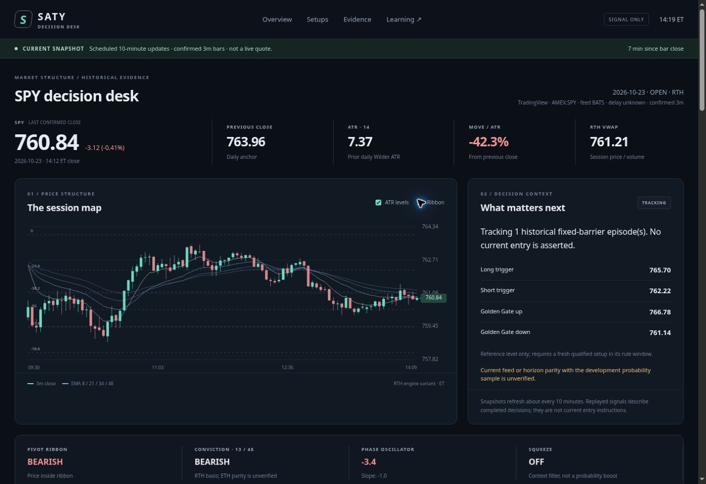

# SATY · SPY decision desk

A small, static decision dashboard around Carter's supplied **`saty-sig-2.0`**
engine. Signal and research support only: no broker integration or order path.

**Planned GitHub Pages address:** https://carterwaynereed.github.io/SATY/

The page uses plain HTML, CSS and JavaScript. A GitHub Action fetches SPY bars,
replays the frozen engine, writes compact JSON, and deploys `site/`. Unusual Whales
is an explicit manual context slot. No TradingView, Yahoo, or UW account secret
is needed or stored.



Preview captured during local validation on October 23, 2026. It is not a claim
that the production Pages deployment is already enabled.

## First deployment

1. Merge the dashboard PR into `main` after **Validate dashboard** passes.
2. In **Settings → Pages → Build and deployment → Source**, select **GitHub
   Actions**. This is required before the Pages deployment succeeds.
3. In **Settings → Actions → General**, ensure Actions are enabled and GitHub's
   official `actions/*` actions are allowed. The workflow explicitly requests
   `contents: write`, `pages: write`, and `id-token: write`; the first scope saves
   generated state on `dashboard-data`. If repository policies restrict pushes,
   permit this workflow to update that generated branch. It does not push `main`.
4. Open **Actions → Update and deploy dashboard → Run workflow → main**. A push
   to `main` also starts it. If an initial run occurred before Pages was enabled,
   rerun it after step 2.
5. Wait for the **Deploy GitHub Pages** step and open its reported URL. The
   intended address above is not a claim that Pages is already provisioned.

There are no repository secrets to add. The built-in, short-lived `GITHUB_TOKEN`
is supplied by Actions. The workflow is pinned to official action commit SHAs.
Do not put UW cookies, Discord tokens, TradingView credentials, or private source
material into this public repository.

## What v1 shows

| Section | Contents |
| --- | --- |
| Data health | Confirmed-price timestamp, current/closed/stale/hold state, provider, schedule, source limitations |
| Market strip | SPY last confirmed 3m close, previous daily close, Wilder ATR14, change in dollars/ATR, RTH VWAP |
| Session map | Confirmed candles, EMA ribbon and ATR level toggles; current manually supplied SPY walls can join the map |
| Decision context | Tracked historical episodes, reference levels, direction/phase conflicts, explicit next-condition caveats |
| Indicators | 8/13/21/34/48 EMA stack, 13/48 conviction, Phase Oscillator and slope, squeeze |
| Signal journal | Decision time versus first observation, cohort, modeled next-open entry, original stop, target R, barrier outcomes and separate managed exits |
| Evidence | Named target event, exact denominator, sessions, inferred episodes, raw rate, 95% descriptive interval, source/cutoff gates |
| UW context | Manual gamma regime/GEX, zero gamma, call/put walls, premium, dark-pool references, max pain, scope and timestamp |
| Controlled learning | Research candidates, challenger registry, session templates and review gates |

No scores are presented as a probability of making money. The page will start
with **DATA HOLD** until a successful refresh publishes usable bars.

## Schedule and freshness

The cron is ten minutes, offset from the top of the hour:

```text
4,14,24,34,44,54 13-21 * * 1-5
```

This UTC envelope covers both New York offsets. The XNYS calendar gates actual
refreshes to the regular session plus a 15-minute finalization window, including
holidays and early closes. A manual run or code/data push can refresh the latest
completed session outside trading hours.

GitHub schedules can start late or be dropped under load. This is **periodic
decision context, not a streaming quote or a timely next-open entry service**.
The browser polls the three JSON files every minute while visible and rechecks
age locally every 15 seconds. A 15-minute-old in-session price becomes stale;
refreshing the browser cannot make old data new. Public-repository schedules can
also be disabled by GitHub after prolonged inactivity; check Actions if updates
stop. See the [schedule documentation](https://docs.github.com/en/actions/reference/workflows-and-actions/events-that-trigger-workflows#schedule).

## Data and strategy integrity

- TradingView's supplied unauthenticated chart adapter is the primary source.
  It is unofficial and may be delayed or unavailable. The runner records the
  returned source metadata instead of assuming a real-time or consolidated feed.
- yfinance is a fallback. Both daily and intraday data switch together. Only
  complete sets of three one-minute bars produce a 3m candle. A fallback source
  is displayed and probability headlines are withheld for unverified parity.
- The runner requires 400 continuous prior RTH 3m bars, the session's opening
  bar, valid OHLCV, and sufficient completed daily history. Forming candles are
  excluded. ATR uses completed daily sessions before the decision session.
- The supplied engine stays frozen. Its RTH 13/48 conviction differs from Saty's
  extended-session implementation, as described in the supplied audit. Window
  definitions, context detectors, gap cohorts and the next-open model remain
  explicit. No discretionary Saty equivalence is asserted.
- Stops and targets describe modeled replay geometry. Target-before-original-
  stop outcomes and managed exits are separate. Costs, fills and option returns
  are not modeled.

The original Python files are under `engine/`. SHA-256 hashes in
[`docs/engine-manifest.json`](docs/engine-manifest.json) protect that baseline and
the supplied statistics. The original audit scripts need historical raw files
that were not included in the attachment; v1 does not claim to have rerun that
entire historical audit.

## Honest probabilities

[`stats/signal_stats_v2.json`](stats/signal_stats_v2.json) contains the supplied
34-session development sample, September 4–October 22, 2026. It is unchanged.

The evidence adapter selects **setup + cohort + target index + R bucket**. It
never counts T1/T2/T3 rows as three independent signals. It shows raw hits/total,
sessions represented in that denominator, inferred episode count, a Wilson 95%
interval, ambiguity and timeout information. The interval is descriptive and
does not correct for session clustering. Independence remains unverified because
the supplied observations lack episode IDs; they also pool direction.

The headline historical rate is withheld for fewer than 20 exact-cell events,
unknown source comparability, early-close horizon mismatch, or evidence that was
not available at the modeled decision. The evidence file was built on October
23 at 13:41:53 ET, so it cannot become an earlier October 23 prediction retroactively.
Raw historical counts remain inspectable under the **DEVELOPMENT** label.

The legacy smoothed model pooled target rows. Its diagnostics are retained as
exploratory provenance, but no unvalidated smoothed forecast is published on
setup cards. Adequate counts do not establish predictive skill or profitability.

To deterministically regenerate the compact evidence display without changing
the sample or strategy:

```bash
python scripts/summarize_evidence.py
```

## Fill the Unusual Whales slot

Edit [`site/data/uw.json`](site/data/uw.json) on `main`, preserving its schema:

1. Change `status` to `manual` after entering a real observation.
2. Set `asof` to the source observation timestamp with an offset; set `symbol`
   to `SPY` or `SPX`. Record `method`, `expiry_scope`, and gamma `units`.
3. Fill only values actually shown. Keep unavailable values as `null`.
4. Use the declared flow `window` and `classification`; do not treat call premium
   alone as proof of bullish customer buying.
5. Commit the JSON. The main-branch workflow republishes it alongside the market
   snapshot. Its freshness limit defaults to 15 minutes; expired manual context
   is labeled stale and no longer joins the level map.

SPX remains in index points. Only current, verified **SPY-basis** manual walls
join the SPY ladder. Gamma/flow/dark-pool context never changes the baseline
probability or entry rule in v1. No automated UW account access is performed.

## Durable observations and daily learning

The workflow keeps generated data on the **`dashboard-data`** branch:

```text
latest.json
state/index.json
state/YYYY-MM-DD/observations.jsonl
state/YYYY-MM-DD/outcomes.jsonl
state/YYYY-MM-DD/revisions.jsonl
state/YYYY-MM-DD/refreshes.jsonl
```

First observations preserve geometry, evidence hash, source, timestamp and
evidence available at observation. Later outcomes and provider revisions are
separate records. An engine decision discovered ten minutes afterward is marked
ineligible for timely-entry forward evaluation. The journal is initially a
source/latency/replay audit, not certified live strategy performance.

Use [`learning/README.md`](learning/README.md) for the daily process and promotion
gates. Six open audit questions are registered as **RESEARCH**. Add lessons as
publishable paraphrases with source locators, then preregister one testable
change. Appending a lesson never edits production rules. Any accepted challenger
requires a versioned, reviewed PR with an untouched evaluation and rollback
record. The 30-new-session/100-episode review floor is not proof of an edge.

## Local use and verification

Python 3.12 and Node 20+ are sufficient. Node is only used for the offline frontend
logic test; the deployed page has no Node runtime or package installation.

```bash
python -m venv .venv
source .venv/bin/activate
python -m pip install -r requirements.txt
python scripts/refresh.py --init
python scripts/refresh.py --output site/data/latest.json --state-dir state
python -m http.server 8000 --directory site
```

Open `http://localhost:8000/`. Do not open `index.html` as a `file://` URL because
the browser must fetch its JSON through HTTP.

```bash
python -m unittest discover -s tests -p 'test_*.py' -v
node --test tests/*.test.mjs
python scripts/validate_site.py
```

Tests run offline with deterministic fixtures. The CI workflow does not depend
on a market-data service being up. The deployment workflow performs the real
refresh and publishes HOLD on a feed or persistence failure. The static
validator checks strict JSON, frozen source hashes and a 500 KB artifact budget.

See [`docs/ARCHITECTURE.md`](docs/ARCHITECTURE.md),
[`docs/DATA_CONTRACT.md`](docs/DATA_CONTRACT.md), and
[`docs/supplied-audit.md`](docs/supplied-audit.md) for implementation details and
the supplied audit.
